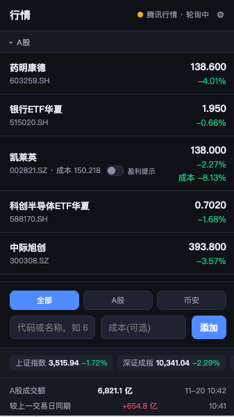

# Market Quotes Assistant

[简体中文](README.md) | English

> For desktop Chrome with Manifest V3 support. Mobile Chrome is not supported. This is a browser extension, not a standalone desktop application, and is not limited to macOS.

A Chrome extension for mainland Chinese, Hong Kong and US stocks, plus Binance USDT perpetual futures. Stocks use **free Tencent quotes by default**, with [TickFlow](https://tickflow.org) as an optional provider requiring an API key. Binance quotes are fetched independently. **Background fetching continues when the popup is closed.**

## Preview



## Features

- Multiple providers: **Tencent** (default, free, no key, 5-second polling), **TickFlow** (WebSocket with REST fallback and network reconnection, API key required), and **Binance futures** (free, no key, independent 5-second polling).
- Select mainland China, Hong Kong, US and Binance markets in settings to limit searching, adding and importing symbols.
- The add area is collapsed by default. Click `添加自选` to expand and switch the search scope among enabled markets. In the all-markets scope, entering `BTCUSDT` or `SNDKUSDT` directly also adds a perpetual contract. Collapsing stops searches and retains input.
- Choose footer quotes by market, including stock indices and BTC / ETH perpetual futures. All footer quotes can be deselected.
- Enabling mainland China automatically displays **total A-share turnover across Shanghai, Shenzhen and Beijing**, plus the change versus the same minute of the previous trading day, in units of CNY 100 million.
- An Offscreen Document owns connections and polling tasks, so closing the popup does not stop quote fetching.
- **Manual reconnection:** click the header refresh icon or status text to retry quote connections.
- **A-share schedule:** automatic fetching runs Monday–Friday, 09:15–15:00 Beijing time, retaining cached data outside those hours. Hong Kong, US and Binance channels are unaffected.
- Add and remove watchlist entries, group by market, enter and edit cost prices and position quantities, and sync through `chrome.storage.sync`.
- Binance USDT perpetuals support **long / short positions and leverage**, displaying P&L amounts and estimated return on initial margin. Legacy spot entries remain unleveraged long positions.
- Enter actual holdings: shares for stocks, underlying quantity (such as BTC) for perpetuals, not a USDT amount. P&L = price difference × quantity × direction; margin return = direction-adjusted price change percentage × leverage. Leverage does not multiply P&L again. Fees, funding and added margin are excluded.
- JSON backups include names, cost prices, quantities, perpetual direction and leverage, and profit-alert settings. Older backups without quantity show no P&L amount; perpetuals default to long at 1×.
- API and Bark keys stay in `chrome.storage.local` and are not synced across devices.
- Red for gains, green for losses; adaptive decimal precision for Binance prices.
- **Display mode:** System / Light / Dark, following the system appearance by default, with the preference saved locally.
- Profit-crossing alerts: when an enabled symbol moves from a loss to a profit relative to its cost price, play a sound and show a toolbar badge. Optional Bark notifications require enabling push and saving a Bark key.
- Pause or resume all quote fetching. Choose between a separate floating window and a regular toolbar popup.

## Installation

1. Download the repository and extract it.
2. Open `chrome://extensions`.
3. Enable **Developer mode** in the top-right corner.
4. Click **Load unpacked** and select the folder containing `manifest.json`.
5. Click the extension icon in the toolbar.

> After changing the code, click **Reload** for the extension on `chrome://extensions`.

## Providers and API Keys

The default stock provider is **Tencent**, which does not require an API key. A previously saved provider selection is preserved when the extension reloads.

| Quotes | Provider | Notes |
|--------|----------|-------|
| Mainland China / Hong Kong / US watchlist and mainland China / US footer indices | Tencent (default) or TickFlow | Select the stock provider in settings |
| Hong Kong footer indices | Tencent | Independent of the selected stock provider |
| A-share turnover and same-minute comparison | Eastmoney total A-share market | Independent, no key required |
| Binance perpetual futures | `fapi.binance.com` | Independent, no key required |
| Legacy Binance spot entries | `data-api.binance.vision` | Remain spot entries; no automatic futures conversion |

Only TickFlow requires setup:

1. Register and sign in at <https://tickflow.org>.
2. Generate an API key in the dashboard.
3. Open the extension settings, select TickFlow, paste the key and save it.

## Display Mode

Open settings and select a display mode. Changes apply immediately; there is no need to click the key-save button.

- **System** (default): use the system's light or dark appearance and automatically update when it changes.
- **Light / Dark:** keep the selected appearance regardless of system changes.
- The preference is saved in `chrome.storage.local`, retained when reopening, and not synced through the Chrome account. Simultaneously open popup and floating windows update together.
- Switching display modes does not affect quote fetching or interrupt position editing.

## Manual Reconnection and A-Share Hours

- When quotes fail, click the header refresh icon or status text to close and restart the current quote connections and polling tasks. The button spins and is disabled while the reconnection request is pending. Reconnection is unavailable while fetching is paused.
- After TickFlow falls back to REST, manual reconnection retries WebSocket access. Invalid keys, plan restrictions and provider outages still require separate resolution; reconnection does not guarantee recovery.
- A-share stocks (including ETFs), footer indices and turnover are fetched automatically only **Monday–Friday, 09:15 ≤ time < 15:00 Beijing time**, without an additional lunch-break pause. Automatic requests stop at 15:00 and on weekends, and resume at 09:15 on the next weekday. Hong Kong, US and Binance channels continue independently.
- Opening the extension, rebuilding its background document, reconnecting or switching stock providers retains saved last prices. Updates from Binance or other markets do not erase A-share quotes. No A-share snapshot is fetched outside these hours; missing cached data displays `—`. The cache may contain the last update before closing rather than final closing data. The turnover refresh button can fetch once outside these hours without restarting automatic polling.
- Scheduling uses weekdays and time only. **There is no holiday trading calendar**, so requests still run during these hours on weekday holidays.

## Markets and Footer Quotes

- **Markets:** all four markets are enabled by default; at least one must remain enabled. Searching, adding and importing only accept enabled markets. If only one market is enabled, the add area uses it automatically and hides the scope buttons.
- **Existing watchlist:** disabling a market does not delete its existing entries or stop fetching their quotes merely because the market is disabled. A-share entries remain subject to the automatic schedule above.
- **Footer quotes:** all items are selected by default and can all be deselected. Disabling a market hides its footer and stops the corresponding footer subscriptions while preserving selections. Re-enabling the market restores them. A contract also present in the watchlist continues to receive quotes.

| Market | Available footer quotes |
|--------|-------------------------|
| Mainland China | SSE Composite, Shenzhen Component, ChiNext, CSI 300, SSE 50, STAR 50 |
| Hong Kong | Hang Seng, Hang Seng China Enterprises, Hang Seng TECH |
| US | Nasdaq, S&P 500, Dow Jones |
| Binance | BTC perpetual, ETH perpetual |

### A-Share Turnover

When mainland China is enabled, the footer automatically displays **cumulative turnover across Shanghai, Shenzhen and Beijing A-shares**, in units of CNY 100 million (`亿`). It remains visible even when all footer indices are deselected. Eastmoney data is requested independently every 5 seconds during the A-share automatic hours above, without an API key and regardless of the stock provider.

- Click the refresh icon beside the A-share turnover label to update both turnover and the same-minute comparison. The icon spins and is disabled during refreshing, and is unavailable while fetching is paused. A manual refresh remains available outside automatic hours without restarting polling. In-flight automatic and manual refreshes share requests without reconnecting other quote channels.
- The comparison uses cumulative turnover at the **same minute of the previous trading day**, with a red `+` for an increase and a green `-` for a decrease. Historical intraday data comes from the server; the extension need not have been open the previous day.
- Live turnover and the comparison have separate timestamps. Only completed minutes available on both days are compared, so the comparison may lag slightly behind the live total. Neither yesterday's full-day total nor an unfinished minute is used for the difference.
- Trading dates come from the API. On non-trading days, the actual data date is retained rather than relabeled as today. Missing comparison data is shown as `—`. Fetch failures retain available data and show an update-failed indicator.
- Disabling mainland China hides the section and stops its requests. Pausing quote fetching also pauses turnover requests. The public Eastmoney endpoints have no stability guarantee; polling frequency does not imply real-time source data.

## Symbol Format

Stocks use `code.market`. Newly added Binance futures use `pair.PERP`.

| Market | Suffix | Examples |
|--------|--------|----------|
| Shanghai A-shares / ETFs | `.SH` | `600000.SH`, `510300.SH` |
| Shenzhen A-shares / ChiNext / ETFs | `.SZ` | `000001.SZ`, `300750.SZ`, `159915.SZ` |
| Beijing Stock Exchange (not supported by Tencent) | `.BJ` | `920662.BJ` |
| US | `.US` | `AAPL.US`, `SNDK.US` |
| Hong Kong | `.HK` | `00700.HK` |
| Binance USDT perpetual futures | `.PERP` | `BTCUSDT.PERP`, `CXMTUSDT.PERP`, `SNDKUSDT.PERP` |
| Legacy Binance spot entries / backups | No suffix | `BTCUSDT`, `ETHUSDT` |

### Binance Futures Search and Legacy Spot Entries

- Search uses Binance futures `exchangeInfo` and supports USDT perpetual contracts of type `PERPETUAL` or `TRADIFI_PERPETUAL`. Search by `BTC`, `CXMT`, `sndkusdt` or a complete `.PERP` symbol.
- Results identify perpetual contracts. Adding `BTCUSDT` saves `BTCUSDT.PERP`. The contract must exist in the fetched catalog; catalog failures or missing contracts prevent addition.
- The catalog includes public API statuses `TRADING` and `TRADING_HALT`, excluding pending listings, settling/delisted contracts and non-perpetual products. **Public API status is not equivalent to actual trading availability in the Binance app.**
- Futures quotes use the latest trade price from `/fapi/v1/ticker/24hr`, not the spot, mark or index price. Percentage changes cover **24 hours**, not a stock-market trading day. If the 24-hour opening price is unavailable or invalid, the latest price is still displayed and the percentage shows `—`.
- Each contract updates as its response arrives, without waiting for other contracts. Unfinished polling rounds are not duplicated. Failures retain cached prices; the header status and tooltip identify the failing contract and HTTP, timeout, network or data error. Click reconnect to retry.
- Chrome must be able to reach `fapi.binance.com`. If direct access fails but a proxy works, check whether Chrome uses that proxy. Reconnection cannot resolve certificate trust or network routing issues; the extension never disables certificate verification or substitutes spot prices for futures prices.
- Existing Binance entries without a suffix remain **spot** entries and are labeled accordingly. To switch, remove the spot entry and add the futures contract. Costs and alert settings are not migrated automatically.
- Imports preserve `.PERP` as futures and legacy unsuffixed entries as spot. Entries from disabled markets, duplicates and invalid formats are skipped.

## Architecture

```text
popup.js ── read cache / render / manage watchlist ──▶ chrome.storage
                                                        ▲
offscreen.js ── quotes / status messages ──▶ background.js (SW)
      ▲                                        │
      └──── config-changed messages ◀──── storage.onChanged
```

- **market-config.js:** shared market groups, footer catalog, configuration normalization and position P&L calculation.
- **offscreen.js:** owns the TickFlow WebSocket and polling for Tencent, Hong Kong indices, legacy Binance spot, Binance futures and Eastmoney A-share turnover. Network disconnection triggers 5-second REST fallback and exponential WebSocket retry delays of 1, 2, 4 seconds and so on, capped at 10 minutes. Explicit server rejection falls back without automatic WebSocket retries. Quotes are merged by timestamp and reported only when changed; the Service Worker persists them because offscreen documents cannot access `chrome.storage` directly. Duplicate futures in the watchlist and footer share requests. Editing position fields, names or alert flags does not reconnect.
- **background.js:** Manifest V3 Service Worker that creates and checks the offscreen document, bridges messages and storage, persists quotes/status, and forwards provider, key, pause, market, footer and watchlist changes.
- **popup.js:** reads cached quotes, listens for storage updates, renders the UI, manages settings/watchlist/backups and searches symbol catalogs. Settings stay synchronized between simultaneously open popup and floating windows.

## Limitations and Storage

- **Quote freshness:** polling every 5 seconds does not guarantee real-time prices. Market closures, API caches, network conditions and product differences can cause stale quotes. Data is for reference only and may differ from trading apps.
- **Tencent:** free 5-second polling, not WebSocket streaming. Supports mainland China, Hong Kong and US stocks. Mainland quotes are generally available intraday; Hong Kong quotes are usually delayed by about 15 minutes. US real-time coverage and pre-market / after-hours / overnight sessions are not guaranteed. **Beijing Stock Exchange is not supported**; missing `.BJ` quotes display `—`. Name search uses Tencent's suggestion endpoint and accepts Chinese names, pinyin and codes.
- **TickFlow:** symbol counts and refresh limits depend on current plan and API permissions. Rejected WebSocket access falls back to REST. Missing or invalid keys are reported.
- **Binance:** futures use `fapi.binance.com`; legacy spot uses `data-api.binance.vision`. Neither requires a key. Polling does not guarantee that every product trades all day or always has a fresh quote.
- **Watchlist capacity:** `chrome.storage.sync` has an 8 KB per-item limit. Capacity depends on symbol and name lengths. Failed saves are reported; reduce entries or export a JSON backup. Backups contain only the watchlist, not keys or other settings.
- **Sync scope:** the watchlist syncs through the Chrome account. Provider choice, keys, enabled markets, footer selections, display mode and switches are local to the device.
- **Background lifecycle:** the offscreen document is created at browser startup, extension load or popup opening. A Service Worker alarm checks every 5 minutes and recreates it if missing. Pausing fetching stops all quote channels.
- **Floating window:** enabled by default. Chrome has no always-on-top window API, so other windows may cover it. It stays open when clicking a webpage; it is not guaranteed to remain on top. Disable the option for a regular popup.
- **Icons:** built-in blue rounded chart icons at 16 / 32 / 48 / 128 pixels are used for the toolbar, extension list and standalone window. Reload the extension and reopen its window after icon changes.

## Files

```text
manifest.json    Manifest V3 configuration
icons/           16 / 32 / 48 / 128 px extension icons
market-config.js Shared market and footer configuration
background.js    Service Worker, offscreen checks, storage and Bark push
offscreen.html   Hidden document skeleton
offscreen.js     Background WebSocket and multi-provider polling
popup.html       Popup markup
popup.css        Styles
popup.js         Rendering, settings, search, watchlist and backups
README.md        Simplified Chinese documentation
README.en.md     English documentation
```

## License

This project is licensed under the [MIT License](LICENSE).
