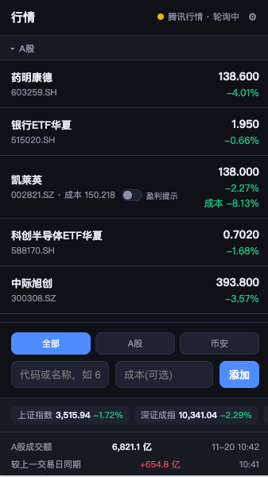

# 行情助手

简体中文 | [English](README.en.md)

> 适用于支持 Manifest V3 的桌面版 Chrome；不支持手机端 Chrome。不是独立桌面应用，也不限定 macOS。

一个 Chrome 行情插件：显示 A 股、港股、美股与币安 USDT 永续合约行情。股票默认使用**腾讯免费行情**，也可切换到 [TickFlow](https://tickflow.org)（需 API Key）；币安行情独立获取，不受股票数据源切换影响。**后台常驻获取**，弹窗关闭后仍持续更新。

## 界面预览



## 功能

- 多数据源：**腾讯**（默认，免费无需 Key，5 秒轮询）、**TickFlow**（WebSocket 推送，失败降级 REST 轮询，网络断线后定时尝试恢复，需 API Key）、**币安合约**（免费无需 Key，5 秒轮询，与股票源并行）
- 设置中的**交易市场**支持多选 A 股 / 港股 / 美股 / 币安，限制搜索、添加和导入范围
- 添加区域默认收起，点击「添加自选」展开；可在已开启的市场中切换搜索范围，「全部」下直接输入 `BTCUSDT`、`SNDKUSDT` 也能添加永续合约；收起后停止搜索并保留输入
- **底部关注行情**按市场配置，支持 A 股指数、港股指数、美股指数及 BTC / ETH 永续合约，可全部取消
- 开启 A 股市场后自动显示**沪深京全 A 成交额**及较上一交易日同分钟的增减额，单位为亿元
- **后台常驻**：Offscreen Document 持有连接和轮询任务，弹窗关闭不影响行情获取
- **手动重连**：点击顶栏刷新图标或状态文字，重新尝试连接行情
- **A 股自动停取**：北京时间周一至周五 09:15–15:00 自动获取，盘后和周末保留缓存；港股、美股和币安不受影响
- 自选股增删、市场分组，支持录入和编辑成本价、持仓数量，跨设备同步（`chrome.storage.sync`）；分组栏显示本市场合计盈亏，折叠后仍随行情更新，以 CNY / HKD / USD / USDT 原币种展示，不跨币种换算。仅汇总有成本、数量及有效报价的持仓，无可计算金额时显示 `—`
- 币安 USDT 永续支持**仅看行情 / 做多 / 做空**；新增默认仅看行情，此时禁用杠杆，不显示持仓详情、盈亏或盈利提示，也不计入市场合计。选择做多 / 做空后可填写杠杆，展示盈亏金额和保证金收益率；旧现货仍按无杠杆多头计算
- 数量按实际持仓录入：股票为股数，合约为标的数量（如 BTC），不是 USDT 金额。盈亏金额＝价差 × 数量 × 方向；保证金收益率＝方向调整后的价格涨跌幅 × 杠杆，不重复放大金额，未计手续费、资金费或追加保证金
- 自选股 JSON 导出 / 导入，包含名称、成本、数量、合约方向与杠杆及盈利提示开关，保留仅看行情的空方向；旧备份缺少数量时不显示金额，缺少方向的合约默认做多、1 倍
- API Key 和 Bark 推送 Key 本地保存（`chrome.storage.local`，不随账号同步）
- 红涨绿跌，币安价格按量级自适应小数位
- **显示模式**支持跟随系统 / 日间 / 夜间，默认跟随系统外观，选择在本机保存
- 扭亏为盈提醒：设置成本并开启标的盈利提示后，由亏转盈时播放提示音并显示工具栏「盈」角标；另行开启 Bark 推送并填写 Key 后可推送到手机
- **获取行情**开关暂停 / 恢复所有后台行情；**悬浮窗口**开关控制点击图标打开独立小窗还是普通弹窗

## 安装

1. 打开 `chrome://extensions`
2. 右上角开启「开发者模式」
3. 点「加载已解压的扩展程序」，选择本目录（`行情插件/`）
4. 点击工具栏上的插件图标

> 改动代码后，记得在 `chrome://extensions` 点本插件的「重新加载」按钮。

## 数据源与 API Key

默认使用**腾讯（免费）**，无需 API Key。已经保存过的数据源选择会保留，不会在重新加载后自动切回腾讯。

| 行情 | 数据源 | 说明 |
|------|--------|------|
| A 股 / 港股 / 美股自选及 A 股 / 美股底部指数 | 腾讯（默认）或 TickFlow | 在设置中切换股票数据源 |
| 港股底部指数 | 腾讯 | 即使股票选择 TickFlow，也由腾讯获取 |
| A 股成交额及同期差额 | 东方财富全 A（沪深京） | 独立获取，无需 Key；同期按分钟对齐 |
| 币安永续合约 | 币安合约接口 `fapi.binance.com` | 独立获取，无需 Key |
| 旧币安现货自选 | 币安公开数据域名 `data-api.binance.vision` | 保留现货含义，不自动转成合约 |

仅切换到 TickFlow 时需要：

1. 访问 <https://tickflow.org> 注册并登录
2. 在控制台生成 API Key
3. 打开插件 → 设置 → 选择 TickFlow → 粘贴 Key → 保存 Key

## 显示模式

打开设置，在「显示模式」中选择，切换立即生效，无需点击「保存 Key」。

- **跟随系统**（默认）：根据系统深浅色外观显示，系统外观变化时自动切换。
- **日间 / 夜间**：固定使用所选配色，不受系统外观变化影响。
- 选择保存在本机 `chrome.storage.local`，重新打开后保留，不随 Chrome 账号同步；同时打开的弹窗与悬浮窗会同步切换。
- 切换显示模式不影响行情获取，也不会打断持仓编辑。

## 手动重连与 A 股时段

- 行情异常时，点击顶栏刷新图标或状态文字，关闭并重新建立当前行情连接和轮询。重连请求期间按钮旋转并禁用；暂停获取时不可重连。
- TickFlow 降级为 REST 后，手动重连会重新尝试 WebSocket；无效 Key、套餐权限或数据源故障仍需分别处理，重连不保证恢复成功。
- A 股股票（含 ETF）、底部指数和成交额仅在**北京时间周一至周五 09:15 ≤ 时间 < 15:00**自动获取，午休不额外停取。15:00 起及周末停止自动请求，下一周一至周五的 09:15 自动恢复；港股、美股和币安继续独立更新。
- 盘后打开插件、重建后台、手动重连或切换股票源均保留已存的最后价格；币安等其他市场更新不会抹掉 A 股缓存。盘后不补取 A 股行情，无缓存时显示 `—`。缓存可能停留在收盘前最后一次更新，不保证包含最终收盘数据；成交额可用其旁的刷新按钮单次补取，不恢复自动轮询。
- 当前按星期和时间判断，**未接入节假日交易日历**，工作日节假日仍会在上述时段请求。

## 交易市场与底部行情

- **交易市场**：在设置中多选 A 股 / 港股 / 美股 / 币安，默认全部开启，至少保留一个市场。搜索、添加和导入仅接受已开启的市场；只开启一个市场时，添加区自动使用该市场并隐藏市场切换按钮。
- **已有自选**：关闭某个市场不会删除该市场已有的自选，也不会因关闭市场停止这些自选的行情获取；A 股自选仍受上述自动时段限制。
- **底部关注行情**：在设置中选择需要展示的项目，默认全部选中，可全部取消。关闭市场时隐藏该市场的底部行情并停止相应底部订阅，但保留勾选记录；重新开启后恢复展示。若同一合约也在自选中，其行情仍会获取。

| 市场 | 底部可选行情 |
|------|--------------|
| A 股 | 上证指数、深证成指、创业板指、沪深300、上证50、科创50 |
| 港股 | 恒生指数、国企指数、恒生科技 |
| 美股 | 纳斯达克、标普500、道琼斯 |
| 币安 | BTC 永续、ETH 永续 |

### A 股成交额

开启 A 股市场后，底部自动显示**沪深京全 A 累计成交额**，单位为亿元；即使取消所有底部指数，成交额仍会显示。数据独立取自东方财富，无需 Key，不受腾讯 / TickFlow 切换影响，在上述 A 股自动时段内每 5 秒请求一次。

- 点击「A股成交额」旁的刷新图标可手动更新成交额和同期比较；刷新时图标旋转并禁用，暂停获取时不可点击。盘后仍可单次刷新，不恢复自动轮询；进行中的自动与手动刷新共享请求，不重连其他行情。
- 同期差额：与**上一交易日同一分钟**的累计成交额相比，增加为红色 `+`，减少为绿色 `-`。历史分时取自服务端，无需前一天打开插件。
- 实时总额与同期比较分别显示时间；同期按双方已完成的分钟对齐，盘中可能比实时总额稍晚，不使用昨日全天成交额或未完成分钟计算差值。
- 以接口返回的交易日期为准；休市时保留实际数据日期，不将上次交易数据标成今天。同期数据缺失时显示 `—`，获取失败时保留已取得的数据并标注「更新失败」。
- 关闭 A 股市场时隐藏并停止获取；关闭「获取行情」时暂停。东方财富公开行情接口没有稳定性保证，刷新频率不代表源数据实时。

## 代码格式

股票使用「代码.市场后缀」；新增币安合约保存为「交易对.PERP」。

| 市场 | 后缀 | 示例 |
|------|------|------|
| 沪市 A 股 / ETF | `.SH` | `600000.SH`、`510300.SH` |
| 深市 A 股 / 创业板 / ETF | `.SZ` | `000001.SZ`、`300750.SZ`、`159915.SZ` |
| 北交所（腾讯不支持） | `.BJ` | `920662.BJ` |
| 美股 | `.US` | `AAPL.US`、`SNDK.US` |
| 港股 | `.HK` | `00700.HK` |
| 币安 USDT 永续合约 | `.PERP` | `BTCUSDT.PERP`、`CXMTUSDT.PERP`、`SNDKUSDT.PERP` |
| 旧币安现货自选 / 旧备份 | 无后缀 | `BTCUSDT`、`ETHUSDT` |

### 币安合约搜索与旧现货

- 搜索使用币安合约 `exchangeInfo` 列表，仅支持 USDT 永续合约，包括普通永续（`PERPETUAL`）和传统资产永续（`TRADIFI_PERPETUAL`）。可输入 `BTC`、`CXMT`、`sndkusdt` 或完整 `.PERP` 代码搜索。
- 搜索结果显示为「交易对 永续」；输入 `BTCUSDT` 添加时自动保存为 `BTCUSDT.PERP`。添加时检查合约是否在列表中；列表获取失败或未找到合约时不会添加。
- 列表包含公开接口状态为 `TRADING` 或 `TRADING_HALT` 的合约，排除待上市、结算下架及非永续品种。**公开接口状态不等同于币安 App 的实际交易状态**，不能仅凭该字段判断 App 是否可交易。
- 合约行情取 `/fapi/v1/ticker/24hr` 的最新成交价，不是现货价、标记价格或指数价格；涨跌幅按 **24 小时**计算，不是股票的当日涨跌幅。缺少有效的 24 小时起始价时仍显示最新价，涨跌幅显示 `—`。
- 各合约响应后独立更新，不等其他合约完成；同一轮请求未完成时不重复发起。失败时保留已有价格，顶栏状态及其悬浮提示包含失败合约和 HTTP、超时、网络或数据错误，可点击重连重试。
- Chrome 需能访问 `fapi.binance.com`。如果直连不可用而代理可以访问，应检查 Chrome 是否使用该代理；重连不能解决证书信任或网络路由问题，插件不会关闭证书校验或用现货价替代合约价。
- 原有无后缀的币安自选继续获取**现货**行情，并显示「现货」。切换合约需移除旧现货后重新添加；不会自动迁移成本或盈利提示开关。
- 导入备份时，带 `.PERP` 的条目保留合约含义，无后缀的旧条目保留现货含义；未开启市场、重复或格式无效的条目会跳过。

## 架构

```
popup.js ──读缓存/渲染/管理自选股──▶ chrome.storage
                                     ▲
offscreen.js ──sendMessage(quotes/status)──▶ background.js(SW) ──写──▶ storage
      ▲                                            │
      └──onMessage(config-changed)◀──storage.onChanged(配置/自选股变化)
```

- **market-config.js**：共享市场分组、底部行情目录、配置规范化及持仓盈亏计算逻辑。
- **offscreen.js**：持有 TickFlow WebSocket，以及腾讯、港股指数、币安旧现货、永续合约和东方财富 A 股成交额的轮询任务。WS 网络断线后降级为每 5 秒一次 REST 轮询，按 1→2→4…最长 10 分钟退避重连；服务端明确拒绝 WS 时降级但不自动重试 WS。行情按时间戳合并，仅有变化时上报，由 SW 落盘（offscreen 不能直接访问 `chrome.storage`）。自选与底部的相同永续合约合并请求；只改持仓字段 / 提示开关 / 名称时不重连。
- **background.js**：MV3 Service Worker。创建并检查 offscreen，作为 offscreen ↔ storage 的桥，接收行情 / 状态消息并写入 `storage`；监听数据源、Key、获取开关、交易市场、底部行情和自选变化，通知 offscreen。
- **popup.js**：读取行情缓存、监听 `storage.onChanged` 刷新、管理设置和自选股，并查询标的列表；弹窗与悬浮窗同时打开时设置互相同步。

## 说明

- **行情时效**：每 5 秒请求一次不代表源数据实时。休市、接口缓存、网络或交易品种差异均可能导致价格不更新；展示仅供参考，不保证与交易 App 完全一致。
- **腾讯数据源**：免费无需 Key，5 秒轮询（非 WebSocket 推送）。支持 A 股、港股和美股；A 股通常提供盘中行情，港股通常约 15 分钟延迟，美股不保证实时或覆盖盘前 / 盘后 / 夜盘。**不支持北交所**（`.BJ` 无行情时显示「—」）；名称搜索走腾讯搜索联想接口，可按中文名、拼音或代码搜索。
- **TickFlow 权限**：WebSocket 推送及 REST 的标的数量、刷新频率限制以 TickFlow 当前套餐和接口权限为准；WS 被拒绝后会降级 REST，缺少或无效 Key 会提示。
- **币安数据源**：合约使用 `fapi.binance.com`，旧现货使用 `data-api.binance.vision`，均无需 Key。后台每 5 秒轮询，但不保证所有品种全天可交易或始终有新行情。
- **自选股容量**：自选股存于 `chrome.storage.sync`（单项上限 8KB），可容纳数量取决于代码和名称长度；超出时保存会失败并提示，请删减或用 JSON 导出备份。备份只包含自选股，不包含 API Key、Bark Key 或其他设置。
- **设置同步范围**：自选股随 Chrome 账号同步；数据源、Key、市场范围、底部行情选择、显示模式和各设置开关仅保存在本机。
- **后台连接生命周期**：浏览器启动 / 扩展加载 / 打开弹窗时创建；Service Worker 每 5 分钟检查 offscreen 是否存在并在缺失时重建。暂停获取时停止各行情通道。
- **悬浮窗口的限制**：默认开启独立小窗。Chrome 没有「窗口置顶」API，失焦后可能被其他窗口遮挡；它只能做到「点击网页不自动关闭」。关闭开关则恢复普通弹窗。
- **图标**：内置蓝色圆角走势图图标，提供 16 / 32 / 48 / 128 像素 PNG，用于工具栏、扩展列表及独立窗口；更改后重新加载扩展并重新打开窗口即可生效。

## 文件结构

```
manifest.json    MV3 清单（含 offscreen / alarms / background）
icons/           16 / 32 / 48 / 128 像素插件图标
market-config.js 共享市场与底部行情配置
background.js    Service Worker，检查 offscreen + 写 storage + Bark 推送
offscreen.html   隐藏页面骨架
offscreen.js     后台 WebSocket + 多源轮询 + 消息上报
popup.html       弹窗结构
popup.css        样式
popup.js         读缓存渲染 + 设置 / 搜索 / 自选股 / 备份管理
```

## 许可证

本项目采用 [MIT License](LICENSE)。
